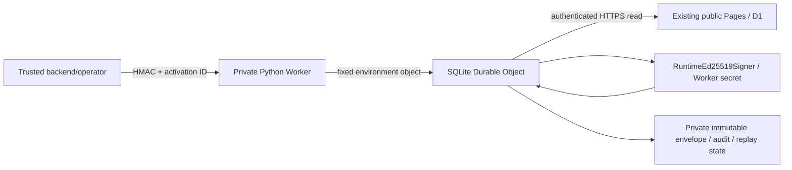

# Cloudflare private Python signing Worker

This implements the closed-beta deployment adapter, without deployment or real
credential/key provisioning. The public Pages/Functions/D1 website is unchanged.
No VPS, public signing route, licence format, entitlement rule, device-limit rule,
revocation rule or offline grace is introduced.

## Architecture and project



`cloudflare/signing_worker/` is a separate project:

- `src/entry.py`: Python Worker `Default` and `SigningCoordinator` Durable Object;
  bounded request handling, async authoritative reads, private persistence result.
- `src/storage.py`: Durable Object SQL facade, durable nonce journal, fenced lease
  and private issuance/audit database adapter. It does not use Python `sqlite3`.
- `wrangler.toml`: explicitly separate staging/production Workers and SQLite DO
  bindings/migration; no secret values, public routes, workers.dev or preview URLs.
- `pyproject.toml`, `uv.lock`, `pylock.toml`: pinned native tooling and actual
  Pyodide runtime dependencies. `package.json`/lock pin Wrangler separately.
- `.generated/`: ignored build output containing allowlisted shared source copies,
  inert package initializers and a generated canonical beta grant manifest.

`scripts/build_cloudflare_signing.py` prepares the bundle and has an unconditional
`--dry-run` deployment command. It cannot perform a live deployment. It invokes the
native uv executable so SDK subprocesses select their own Pyodide environment.
Generated output, vendored packages, environments, local state and dotenv variants
are ignored by Git. No local secret fixture remains from validation.

The adapter reuses `PrivateSigningService`'s validation/persistence/response stages,
`issue_website_activation`, the shared worker eligibility/history helpers, original
entitlement validation, `RuntimeEd25519Signer`, existing canonical serialization
and `LeaseVerifier`. Callback transactions let the same issuance body run under
local SQLite or Cloudflare `transactionSync`; the state machine is not duplicated.
The normal Python service and local TEST worker keep their existing execution path.

The canonical catalogue/registry derive the beta grants during bundle preparation.
The generated `frozen_profile.py` contains that reviewed build's public grant list;
it is not a second hand-maintained policy or a website/caller-controlled grant list.
Source hashes and generated grants are recorded in `source_manifest.json`. Rebuild
from an approved revision when policy changes; do not edit `.generated/` manually.
Desktop startup, DPAPI provisioning, local key files and scientific/frontend runtime
dependencies are excluded. No production key is generated during this build.

## Endpoint, authentication and secrets

Only HTTPS `POST /v1/licences/issue` is handled. The schema, maximum 2048-byte body,
HMAC-SHA256 proof, +/-120-second freshness window and safe response codes remain
those in `PRODUCTION_SIGNING_SERVICE.md`. Callers submit only schema version and a
canonical activation UUID. Grant/device/account/expiry/key payloads are rejected.
Body streams and authoritative export streams are bounded. Freshness is checked
AFTER body reading, before persistence, and before returning an envelope.

The Worker authenticates before routing to a DO. The DO authenticates again before
consuming a nonce. Browser/session/device credentials do not authenticate issuance.
No alternate RPC signing method or unauthenticated status/health endpoint is added.
The fixed object name is configuration, never selected from the request.

Crypto imports are deferred to authenticated DO request handling: the WASM crypto
backend requires entropy during import and cannot initialize during the Worker
module snapshot. Private key loading and signing occur only in the private Worker
runtime using bindings; there is no process-environment or file-key fallback.
The bound signer retains only its validated public deployment mode for environment
checks, without placing private bindings in process-wide `os.environ`.

| Binding/configuration | Scope | Secret? |
| --- | --- | --- |
| `BETA_ENVIRONMENT` | Exact `staging` or `production` | No |
| `QS_OPERATOR_WEBSITE_URL` | Approved public HTTPS root origin; blank fails closed | No |
| `QS_LICENCE_SIGNING_ISSUER_ID` | Approved stable production-style signed `kid` | No |
| `QS_LICENCE_SIGNING_PUBLIC_KEY` | Matching canonical 32-byte public pin | No |
| `SIGNING_COORDINATOR` | DO namespace binding to class `SigningCoordinator` | No |
| `QS_SIGNING_OBJECT_NAME` | Exactly `quantum-studio-signing-<environment>-v1` | No; durable identity, keep stable |
| `QS_LICENCE_SIGNING_KEY` | Existing strict environment-tagged Ed25519 secret JSON | YES; encrypted Worker secret only |
| `QS_SIGNING_SERVICE_AUTH` | Existing environment-tagged per-caller HMAC allowlist JSON | YES; encrypted Worker secret only |
| `QS_OPERATOR_SYNC_TOKEN` | Existing authenticated website export read credential | YES; encrypted Worker secret only |

The checked-in issuer, public pin and origin values are blank intentionally. All
real values require independent review/provisioning. Secret JSON must be supplied
as the JSON record itself, not a JSON-encoded string containing that record. Neither
secrets nor credentials belong in Wrangler `[vars]`, source, build artifacts, desktop
builds or the public website's signing-key bindings. The public website may later
hold only its own approved caller HMAC key; never the full caller allowlist or the
licence private key. Caller invocation is not wired into the website in this step.

## Durable Object storage and serialization

There is one canonical object per environment, checked against its namespace-derived
ID even if a binding calls the DO directly. Staging and production use separate
Worker scripts, namespaces, object names, trust, callers and secrets. Persistent
metadata binds environment and authoritative origin; mismatches fail closed.
Never rename/clone the production Worker, DO class or object name as a rollout tactic.
A fresh namespace is fresh authority storage, not a safe retry or a key rotation.

The private SQL store contains nonce claims/expiry, clock high-water, a fenced lease,
public deployment metadata, original entitlement snapshots, public signing keys,
immutable envelopes and the existing tamper-evident audit chain. It stores no private
signing/HMAC key. It is distinct from public website D1. Local file paths and the
`QS_SIGNING_SERVICE_STATE_PATH` setting are not deployment dependencies here.

Atomic `transactionSync` callbacks initialize/bind state and consume `(caller,nonce)`.
Claims survive request failure and object eviction/restart. Expired nonce cleanup
never permits an original still-fresh proof to replay; clock rollback below the
persisted high-water fails closed. SDK callback errors preserve typed safe rejection
codes across the Python/JavaScript boundary.

A durable 60-second lease uses a random owner, monotonic fencing counter and expiry.
Requests arriving while it is held receive safe HTTP 409 `issuance_busy` and must
retry with a NEW authenticated nonce. The lease covers async authoritative reads,
shared synchronous issuance, private persistence and the final re-read. Source
fetch/body operations have bounded 10-second awaits. No network await occurs inside
a SQL transaction, and no global Python lock is the serialization authority.

Every private write transaction checks owner/fence/clock/expiry before and after
its work. A stale or expired owner cannot commit; the SQL transaction rolls back.
Ownership is checked again after network awaits and before returning the envelope.
A superseded owner cannot release its successor's lease. A failed release leaves
the lease busy until expiry rather than admitting concurrent signing.

Retries with fresh proofs return the original verified envelope/digest and create
no duplicate issuance audit. Replay of the same consumed proof returns 409. An
observed revocation, changed state, expiry or final-read outage withholds the response
envelope. A private original already committed before a failed final read remains
for eligible recovery; it is never re-signed or silently deleted. Website reads and
private persistence are still separate transactions, not a distributed commit.

Success remains `persisted` / `already_current`, NOT website publication. The existing
public production metadata/publication/retrieval gates are unchanged. A later
publication adapter must enforce authoritative binding, immutable digest and terminal
revocation atomically on the website; cached licences still cannot authorize work.

## Local preparation and dry-run validation

From the repository root, with the existing development dependencies installed:

```powershell
.\.venv\Scripts\python.exe -m pip install uv
.\.venv\Scripts\uv.exe sync --project cloudflare/signing_worker --locked
Push-Location cloudflare/signing_worker
npm.cmd ci
Pop-Location
.\.venv\Scripts\python.exe scripts/build_cloudflare_signing.py --environment staging
.\.venv\Scripts\python.exe scripts/build_cloudflare_signing.py --environment production
```

Both build commands unconditionally execute `pywrangler deploy --dry-run`; neither
uploads or provisions resources. SDK tooling downloads its runtime interpreter and
WASM wheels according to the compatibility date; do not copy the desktop venv into
the Worker. The reviewed pins are workers-py 1.17.9, workers-runtime-sdk 1.9.6,
Wrangler 4.158.0 and runtime cryptography 47.0.0. The Pyodide lock selected Python
3.14.2; this is independent of the repository's Python 3.13 test interpreter.
Python Worker tooling and supported package behavior are documented by
[Cloudflare Python packages](https://developers.cloudflare.com/workers/languages/python/packages/).

Build-time syntax/module validation is not production certification. A local SDK
startup and actual HTTPS workerd smoke additionally exercised the real DO SQL/FFI,
request-time crypto initialization, nonce consumption/replay, and full private
issuance/recovery with fixed synthetic secret/key/authoritative fixtures only.
The test fixtures/diagnostic overrides were removed and the clean bundle rebuilt.
No deployed secrets, live approval flow or real production signing key was tested.

## Future manual deployment commands ? NOT executed

First approve the public origin/issuer/public pin in the selected Wrangler profile,
private caller/authority custody, stable names and external resource access. Configure
one environment at a time. The following PowerShell templates contain placeholders
only and are NOT dry-run commands. Provisioning `secret put` itself creates/deploys
a Worker version, so it requires the later explicit deployment authorization.

```powershell
# From repository root: prepare reviewed code, without any upload.
.\.venv\Scripts\python.exe scripts/build_cloudflare_signing.py --environment staging --prepare-only
Push-Location cloudflare/signing_worker

Get-Content -Raw -LiteralPath '<SECURE_STAGING_KEY_RECORD_FILE>' | uv run pywrangler secret put QS_LICENCE_SIGNING_KEY --env staging --name '<STAGING_PRIVATE_WORKER_NAME>'
Get-Content -Raw -LiteralPath '<SECURE_STAGING_CALLER_RECORD_FILE>' | uv run pywrangler secret put QS_SIGNING_SERVICE_AUTH --env staging --name '<STAGING_PRIVATE_WORKER_NAME>'
Get-Content -Raw -LiteralPath '<SECURE_STAGING_EXPORT_TOKEN_FILE>' | uv run pywrangler secret put QS_OPERATOR_SYNC_TOKEN --env staging --name '<STAGING_PRIVATE_WORKER_NAME>'
uv run pywrangler deploy --env staging --name '<STAGING_PRIVATE_WORKER_NAME>' --var 'QS_OPERATOR_WEBSITE_URL:<APPROVED_STAGING_HTTPS_ORIGIN>' --var 'QS_LICENCE_SIGNING_ISSUER_ID:<APPROVED_STAGING_ISSUER_ID>' --var 'QS_LICENCE_SIGNING_PUBLIC_KEY:<APPROVED_STAGING_PUBLIC_KEY>'
Pop-Location
```

After independent production custody and successful staging acceptance:

```powershell
.\.venv\Scripts\python.exe scripts/build_cloudflare_signing.py --environment production --prepare-only
Push-Location cloudflare/signing_worker
Get-Content -Raw -LiteralPath '<SECURE_PRODUCTION_KEY_RECORD_FILE>' | uv run pywrangler secret put QS_LICENCE_SIGNING_KEY --env production --name '<PRODUCTION_PRIVATE_WORKER_NAME>'
Get-Content -Raw -LiteralPath '<SECURE_PRODUCTION_CALLER_RECORD_FILE>' | uv run pywrangler secret put QS_SIGNING_SERVICE_AUTH --env production --name '<PRODUCTION_PRIVATE_WORKER_NAME>'
Get-Content -Raw -LiteralPath '<SECURE_PRODUCTION_EXPORT_TOKEN_FILE>' | uv run pywrangler secret put QS_OPERATOR_SYNC_TOKEN --env production --name '<PRODUCTION_PRIVATE_WORKER_NAME>'
uv run pywrangler deploy --env production --name '<PRODUCTION_PRIVATE_WORKER_NAME>' --var 'QS_OPERATOR_WEBSITE_URL:<APPROVED_PRODUCTION_HTTPS_ORIGIN>' --var 'QS_LICENCE_SIGNING_ISSUER_ID:<APPROVED_PRODUCTION_ISSUER_ID>' --var 'QS_LICENCE_SIGNING_PUBLIC_KEY:<APPROVED_PRODUCTION_PUBLIC_KEY>'
Pop-Location
```

Keep public routes/workers.dev/preview URLs disabled. An approved backend will need
a separately authorized service binding to the selected Worker before it can invoke
this private endpoint. Do not expose a temporary unauthenticated public URL to make
initial testing convenient. Keep HMAC authentication on the service-binding path.
See [service bindings](https://developers.cloudflare.com/workers/runtime-apis/bindings/service-bindings/)
and [encrypted Worker secrets](https://developers.cloudflare.com/workers/configuration/secrets/).

## Rollback and operational recovery

Record approved deployment version IDs and keep the Worker/class/namespace/object
identity stable. Roll code back only to a version compatible with the current SQL
schema and signing configuration; do not reset/delete DO data, roll back nonce clock
state, re-sign envelopes or clone an empty namespace. Preserve historical public
trust through issuer rotation. Revoke a compromised caller independently of code.

A future authorized rollback template is:

```powershell
uv run pywrangler rollback '<APPROVED_PREVIOUS_VERSION_ID>' --env production --name '<PRODUCTION_PRIVATE_WORKER_NAME>'
```

Code rollback does not roll back connected storage, and DO lifecycle migrations may
prevent rollback across incompatible versions. Verify current binding/key versions
and the latest persisted audit/lease state before resuming issuance.
[Cloudflare rollback constraints](https://developers.cloudflare.com/workers/versions-and-deployments/rollbacks/).

## Free-tier assumptions and remaining manual gates

SQLite-backed Durable Objects are available on Workers Free; legacy KV-backed DOs
are not the selected backend. Current included DO allocations cover requests,
duration, row operations and storage; exceeding Free limits fails operations. A
small cohort may fit those allocations, but neither zero cost nor free-plan CPU
suitability is certified by local tests. Recheck the account's actual shared usage,
Python/crypto CPU and startup limits, and retention/growth before selecting a plan.
[Durable Object pricing](https://developers.cloudflare.com/durable-objects/platform/pricing/).

Workers Free has a short per-request CPU allowance (currently 10 ms). Local elapsed
request timings and a successful dry run do not prove compliance; measure real
staging CPU, especially cold Python/WASM crypto imports, before invitations. If the
selected plan is insufficient, fail closed and approve capacity separately; do not
weaken authentication or signing to fit a quota. No paid plan was enabled here.
[Workers platform limits](https://developers.cloudflare.com/workers/platform/limits/).

Manual work remains: approve real non-secret profiles and stable namespace identity;
provision independent staging/production secrets/keys externally; establish private
caller service bindings and access controls; stage migration/backup/recovery and
quota/CPU monitoring; implement separately authorized production website publication/
retrieval; provision desktop public trust; and run real HTTPS acceptance. No deploy,
real key generation, real secret provisioning, public website change, commit or push
was performed by this implementation step.


## Pages issuance integration follow-up

Pages Functions now have a server-only `SIGNING_SERVICE` client and authenticated
`POST /api/operator/activations/<activation-id>/issue` trigger. The body is exactly
`{"schema_version":1}` and the trigger requires the existing
`OPERATOR_LICENCE_PUBLISH_TOKEN`. Local TEST issuance remains unchanged.

Required additional Pages runtime configuration:

- `SIGNING_SERVICE`: Service Binding to the matching private Worker.
- `QS_SIGNING_SERVICE_CALLER`: encrypted JSON secret with exactly `schema_version:1`,
  matching `environment`, approved `caller` and `secret` (canonical unpadded base64url
  of 32 bytes). This is NOT a raw key. Worker `QS_SIGNING_SERVICE_AUTH.callers[caller]`
  must contain the same secret; the Worker allowlist remains authoritative.
- `QS_LICENCE_TRUST`: public JSON manifest with `schema_version:1`, matching
  `environment`, `domain:"licence"`, `algorithm:"Ed25519"` and `keys` mapping approved
  `lic-...` issuer IDs to canonical base64url raw 32-byte public keys. Never supply
  private signing keys to Pages.

Use independent staging/production callers, secrets, trust, D1 and bindings. These
settings are runtime-only, not public build configuration. Missing/invalid settings
fail the issuance operation closed without changing unrelated page/auth behavior.

Pages verifies the HMAC-compatible response envelope's Ed25519 signature against
pinned trust and matches authoritative entitlement/device facts before reusing shared
metadata and immutable publication persistence. Worker replay/freshness/serialization
remain authoritative; retries use fresh nonces and recover the original envelope.
No automatic activation side effect or desktop direct binding access was added.

While DNS is pending, the working HTTPS Pages origin can be used consistently for
Pages `BETA_ALLOWED_ORIGIN` and Worker `QS_OPERATOR_WEBSITE_URL`. Final custom DNS is
not required for Service Binding calls. Public desktop device-proof retrieval/status
now support deployed environments; see `DESKTOP_CLOUD_LICENSING.md` for rollout gates. No deployment or secret provisioning occurred.

See [the full Pages runtime contract and flow](PRODUCTION_SIGNING_SERVICE.md#pages-functions-service-binding-integration)
for exact JSON formats, authentication, failure behavior and manual rollout steps.
