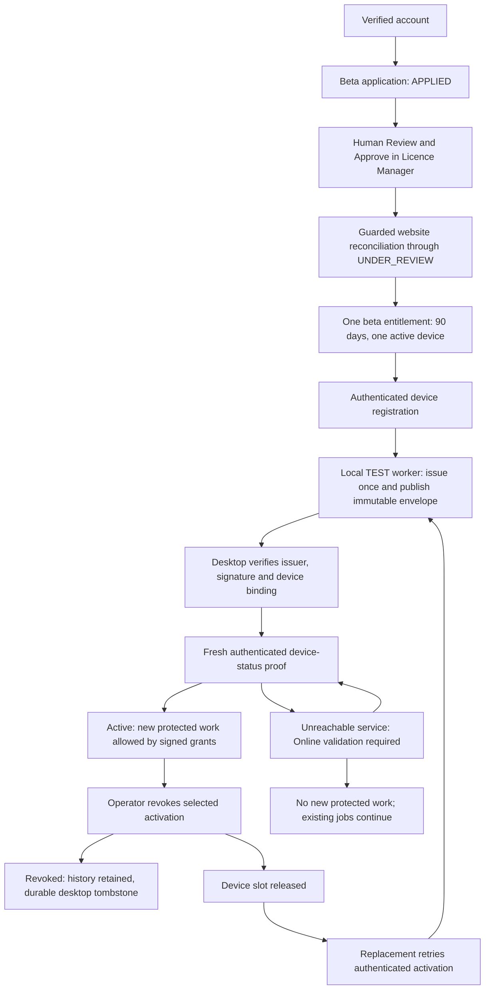

# M10 beta licensing acceptance

M10 validates and hardens M1-M9C; it introduces no new licensing feature. Automated
acceptance and manual GUI acceptance are separate. The manual checklist is
[LICENSING_MANUAL_QA.md](LICENSING_MANUAL_QA.md). This is LOCAL TEST acceptance, not
production approval or a deployment procedure.

## Architecture and supported lifecycle



The website owns account/application/activation/entitlement authority and stores
published public artifacts; it never signs licences. Licence Manager owns human
review and local signing/audit. The desktop owns protected device identity,
verification, durable authorization state, and the central new-work gate.

| Milestones | Current contract |
| --- | --- |
| M1-M3 | Account/application and local operator foundation, explicit issuer trust and signed device binding; existing project/result read access preserved. |
| M4-M6 | Automatic authenticated device evaluation, separate operator metadata sync, browser-assisted desktop activation. |
| M7 | Immutable signed publication, device-proof retrieval, explicit LOCAL TEST trust; delivery is not signing authority. |
| M8 | Local TEST automatic issuance/reconciliation, original-envelope recovery, idempotent publication, per-root worker lock. |
| M9A | Fixed account grant independent of devices: beta, 90 days, device_limit=1; activation history and original expiry retained. |
| M9B | Specific AUTHORIZED activation becomes terminal REVOKED; one audit; slot release; no entitlement mutation. |
| M9C | Fresh online device proof at startup/new protected work; durable revocation; no offline grace or periodic authorization polling. |

## Acceptance evidence and coverage matrix

The new `website/tests/licensing-acceptance.test.mjs` executes actual JavaScript route
functions inside Wrangler, using a disposable **real local D1 binding** migrated from
0001 through latest. `tests/licensing/m10_acceptance_driver.py` uses the actual Python
application/status clients, normal signup + local OTP, normal authenticated desktop
activation, human review transitions, M8 worker, M5 signer, publication, delivery,
revocation client, and desktop service. It keeps one ephemeral signer process alive
across both devices. It closes the HTTP listener for a genuine connection failure,
then reopens the same origin and proves fresh validation restores Active. It does
not fabricate successful status responses. Device keys and operator data are isolated
TEST fixtures; this is not native GUI click-through or a production deployment.

| Acceptance IDs | Automated evidence |
| --- | --- |
| A: 1-6 | Actual-D1 lifecycle; account/status sync suites; APPLIED -> UNDER_REVIEW -> APPROVED, idempotent retry, single unchanged grant. |
| B: 7-12 | Lifecycle and account-entitlement suites: 90-day bounds, one slot, unchanged dates, missing/future/invalid/expired grant denial. |
| C: 13-18 | Lifecycle, M7 delivery and M9C status suites: real signer/proofs, issuer/signature/device/licence/digest binding, idempotent delivery, Active. |
| D: 19-22 | Lifecycle and activation suites: B is FLAGGED, no second signature or grant mutation, only AUTHORIZED consumes slots. |
| E: 23-31 | Lifecycle and revocation/status suites: one reason/timestamp/audit, repeat idempotency, immutable bytes, worker refusal, durable restart denial. |
| F: 32-38 | Lifecycle: B stays FLAGGED until normal authenticated retry, becomes AUTHORIZED after release, receives same original expiry and validates Active. |
| G: 39-46 | Lifecycle physically stops/restores its local listener; B denies offline, A tombstone remains, fresh validation recovers B. |
| H: 47-61 | `test_licence_delivery.py`, `test_device_status.py`, private-manager/worker suites, website device-status/licence-delivery suites: signature/issuer/key/binding/revision/schema/proof/replay/expiry/trust/production denial. |
| I: 62-67 | M9C cache/trust/identity suites plus `test_m10_hardening.py`: corrupt/missing/replaced authorization files cannot grant offline access; fresh server reconciliation cannot resurrect revoked A. |
| J: 68-74 | M9A simultaneous slot test; M9B guard/audit concurrency tests; M10 revoke/replacement thread race and publication-before/after-revoke interleavings; worker recovery/retry/publication suites. |

M10 specifically reproduced a real acceptance defect: `revoked_at` includes fractional
seconds but `server_time` is an integer second. Comparing them at full timestamp
precision misclassified a valid same-second revocation as invalid. The fix accepts
fractional time within the authenticated current second, still rejecting the next
second and later. Regression tests cover both valid fractional and future timestamps.

Other hardening is limited to TEST diagnostics and launcher usability: explicit
coherent session roots, isolated website persistence, A/B helpers, safe secret loading,
clearing stale/mis-inherited operator credentials, correct child-shell dot-sourcing,
and a restart option that reuses an existing website build. The example local origin
matches the helper. No state-machine or signed-grant rule is weakened.

## Local TEST setup and environment

See the exact commands in the manual checklist. Every terminal must use the same
`QS_LOCAL_TEST_ROOT`, loaded before dot-sourcing `scripts/qs-local.ps1`. It derives
operator/, issuer.json, desktop-a/, desktop-b/, and website-state/. Existing QA roots
are not moved, reset, or deleted. A new session means selecting a new unused root.

| Setting | Purpose |
| --- | --- |
| BETA_ENVIRONMENT=local; matching BETA_ALLOWED_ORIGIN | Local website configuration; canonical checklist origin is http://127.0.0.1:8788. |
| BETA_PRIVACY_VERSION, BETA_TERMS_VERSION | Explicit local consent versions. |
| BETA_IDENTITY_PEPPER, AUTH_OTP_PEPPER | Local nonempty secrets; preserve existing values in a continuing session. |
| BETA_TURNSTILE_TEST_MODE=true; AUTH_EMAIL_TEST_MODE=true | Local-only test verification/OTP; never production. |
| OPERATOR_SYNC_TOKEN | Website read export; helper maps to QS_OPERATOR_SYNC_TOKEN. |
| OPERATOR_STATUS_SYNC_TOKEN | Guarded review-status mirror; maps to QS_OPERATOR_STATUS_SYNC_TOKEN. |
| OPERATOR_ACTIVATION_REVOKE_TOKEN | Dedicated device revocation; maps to QS_OPERATOR_ACTIVATION_REVOKE_TOKEN. |
| OPERATOR_LICENCE_SYNC_TOKEN | Licence metadata; maps to QS_OPERATOR_LICENCE_SYNC_TOKEN. |
| OPERATOR_LICENCE_PUBLISH_TOKEN | Public envelope publication; maps to QS_OPERATOR_LICENCE_PUBLISH_TOKEN. |
| QS_OPERATOR_WEBSITE_URL | Set by operator/worker helper to the selected local origin. |
| QS_WEBSITE_URL; QS_DESKTOP_AUTH_ALLOW_LOCAL_HTTP=1 | Set by desktop helpers; no operator credentials are needed by desktop proof. |
| QS_TEST_LICENSING=1; QS_TEST_LICENCE_TRUST_FILE | Explicit TEST trust; key is loaded from local file, never website response. |

Optional launcher overrides: QS_LOCAL_OPERATOR_ROOT, QS_LOCAL_TRUST_FILE,
QS_LOCAL_DESKTOP_A_ROOT, QS_LOCAL_DESKTOP_B_ROOT, QS_LOCAL_WEBSITE_STATE_ROOT,
QS_LOCAL_WEBSITE_URL. Defaults contain no workstation-specific repository path or
credentials. Show-QSConfig prints paths/origin only. Start-QSDesktop remains the A
alias. Start-QSWebsite -SkipBuild supports the outage/restore step after an initial
build. Local D1 migrations and website must use the same website-state directory.

## TEST signer lifecycle (important)

A TEST signing private key exists only in the worker process. Keep that SAME worker
alive from A issuance through B replacement issuance. Repeated polls in that process
reuse its key and trust. Restarting can recover/publish existing stored envelopes
with their original public trust; it cannot produce a new signature under the lost
private key. Prior-issuer/trust conflicts intentionally fail closed.

Do not delete/overwrite issuer.json to fix a conflict. Do not re-sign historical
licences. For a new TEST signing session select a fresh operator root AND fresh trust
file (a fresh complete QA session root is simplest), and normally use a new account
and device roots. For inspection of the old session preserve its roots/envelopes/trust.
M10 does not persist the TEST signing private key, silently rotate trust, or add renewal.
Licence Manager's manual TEST signer is a separate ephemeral process; do not use its
Issue test licence action in the automatic-worker acceptance run.

## Migration compatibility

No M10 migration is added and existing migrations are unchanged. Clean actual D1
acceptance applies 0001 -> latest. `test_m10_migrations.py` applies actual SQL from
clean, M8 (0008), M9A (0010), and M9B (0011) snapshots to latest, checking original
columns/rows, grant dates, licence/publication/challenge foreign keys, revocation
history, PRAGMA foreign_key_check, integrity_check, terminal state, and status tables.
Legacy data lacking enough authoritative entitlement information stays fail-closed;
upgrading is not permission to invent a new 90-day term.

## Troubleshooting and limits

- Missing tables: apply migrations to the same persist-to directory shown by Show-QSConfig.
- Browser origin denied: local URL and BETA_ALLOWED_ORIGIN must match exactly, including host and port. Rebuild when changing public build-time test flags.
- Missing authentication: use the dedicated credential for each operator action; helper reloads .dev.vars and does not print secrets.
- Prior TEST issuer/trust conflict: see signer lifecycle above; preserve artifacts and the old trust file. A restart cannot recover an ephemeral private signing key.
- Online validation required: start/restore the same website origin, then Check licence or attempt a fresh permitted operation; cached success is never an offline grant.
- Invalid licence: inspect signature/device/trust/binding/cache integrity; do not fix it by trusting response-provided keys or bypassing a guard.
- FLAGGED B after A revocation: B must retry normal browser-assisted activation. Slot release does not silently authorize it.
- Corrupt authorization state: fails closed. Preserve evidence and use explicit TEST recovery; ordinary status-file deletion never authorizes a revoked device.
- Revocation does not terminate an already running job. New single/batch workflow launches require fresh validation. Direct headless/external launchers must call the existing protected-work gate.

Production blockers remain: production issuer/trust and protected signing authority,
production email/CAPTCHA/identity configuration and secret provisioning, deployment
review, and final human two-device GUI acceptance. TEST publication/worker remains
local/test only, production signing remains unavailable, website never signs licences.
No billing/payments, renewals, organizations/new commercial plans, customer device
self-service, offline grace, periodic authorization polling, remote wipe, or production
deployment automation is implemented.

## Validation commands

From repository root:

```powershell
.\.venv\Scripts\python.exe -m pytest tests/licensing -q -p no:cacheprovider
.\.venv\Scripts\python.exe -m pytest tests/calculate/test_local_execution.py tests/calculate/test_execution_persistence.py tests/calculate/test_w4_execution_bridge.py tests/calculate/test_w5_indeterminate_execution.py -q -p no:cacheprovider
Push-Location website
npm.cmd test
Pop-Location
git diff --check
```

Focused actual-D1 acceptance: from website/, run
`npm.cmd test -- tests/licensing-acceptance.test.mjs`. Its wrapper and inspection
route exist only in a disposable generated test worker; no test inspection endpoint
is added to shipped website functions. Full licensing includes focused hardening,
helper, migration, worker and status suites. Native startup smoke and manual GUI
click-through must be reported separately.

## Recorded automated M10 result

- Actual-D1 full lifecycle: passed, including real listener outage and recovery.
- Focused website lifecycle/delivery/races: 23 passed.
- Focused Python hardening/migrations/helper/worker: 64 passed.
- Full website: 228 passed across 17 files.
- Full licensing: 401 passed, 4 skipped, 8 subtests passed.
- Execution/protected-work regressions: 29 passed, 17 subtests passed.
- Clean/M8/M9A/M9B upgrade checks and foreign-key/integrity checks passed; no new migration.
- Imports, native desktop GUI startup/close, and Windows-protected identity process-restart smoke passed.
- Manual two-device GUI/running-job checklist: NOT recorded as completed.
- Production acceptance: NOT granted. The production blockers above remain.
