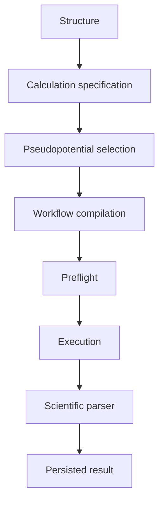

# Calculate

Calculate converts an atomistic structure and a calculation specification into an executable scientific workflow.

## Design principles

1. Generated engine inputs remain inspectable.
2. Pseudopotentials carry provenance and integrity information.
3. Execution success and scientific parsing success are distinct states.
4. Engine-specific parsing does not belong in generic GUI or executor code.
