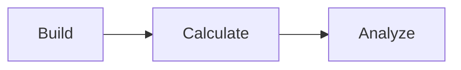

# Quantum Studio 0.2.0

Quantum Studio is a local-first desktop environment for atomistic structure construction, first-principles workflow preparation, execution, and scientific result analysis.

The documentation is organized around the application's computational flow:

## Documentation map

- **Getting Started** — installation and the first project.
- **Builder** — structures, transformations, heterostructures, moiré systems, measurements and reciprocal-space tools.
- **Calculate** — calculation definitions, pseudopotentials, compilation, execution and result parsing.
- **Analyze** — structured scientific results and visualization.
- **Tutorials** — complete calculation workflows from physical problem to interpretation.
- **Concepts** — the underlying DFT and atomistic methods.
- **Reference** — file formats, project structure, technical behavior and provenance.

:::note Controlled technical beta
Quantum Studio 0.2.0 is under controlled beta validation. Documentation pages distinguish READY, PARTIAL, PLANNED, and external-backend-required work rather than presenting planned behavior as complete.
:::
