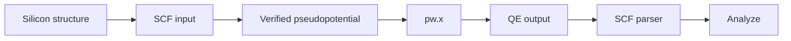

# Silicon SCF — first workflow

This tutorial will become the canonical end-to-end acceptance workflow for Quantum Studio.

## Objective

Construct or import silicon, prepare a Quantum ESPRESSO self-consistent field calculation, execute it, and inspect the parsed total energy in Analyze.

## Workflow

## Scientific result

For the current real regression calculation, the verified Quantum ESPRESSO output produced a final total energy of:

$$
E_{\mathrm{tot}} = -91.29944485\;\mathrm{Ry}.
$$

This value is useful as an end-to-end acceptance fixture only for the specific recorded calculation; it is not a universal silicon reference energy.
